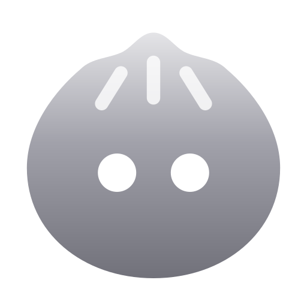

<p align="center">
  
</p>

<h1 align="center">BaoBao (宝宝) 🥟</h1>

<p align="center">
  <b>Dynamic Island Desktop Widget yang Imut, Ringan, dan Produktif untuk Windows & macOS</b><br>
  <i>A cute, sleek & minimalist floating desktop companion powered by Tauri & Rust.</i>
</p>

<p align="center">
  
  
  
  
  
</p>

---

## 📖 Apa itu BaoBao?

**BaoBao (宝宝)** adalah aplikasi *desktop notch & dynamic island widget* yang imut, elegan, dan ringan untuk **Windows** maupun **macOS**.

BaoBao dapat tampil menempel di bagian atas layar layaknya *Notch* maupun mengambang (*Floating Notch*), mengecil menjadi kapsul *mini-pill* yang ringkas, dan melebar (*expand*) menjadi pusat kendali produktivitas multifungsi hanya dengan *hover* atau klik.

---

## ✨ Fitur-Fitur Utama

### 🎵 1. Music Player & Real-time Synced Lyrics
- **Real-time Synced Lyrics**: Menampilkan lirik lagu secara sinkron baris demi baris di **Mini-Pill**, panel lirik samping (*Side Lyrics*), maupun mode lirik penuh (*Full Lyrics Stream*).
- **Kontrol Media & Volume Native**: Tombol *Play/Pause*, *Previous*, *Next*, *progress bar* interaktif (*seek*), serta pengatur volume *master* (mendukung *mouse wheel scroll*).
- **Smart Sound Wave & Sleepy BaoBao**: Visualizer gelombang suara yang hanya tampil saat ada musik aktif, serta animasi maskot BaoBao tertidur (`zZz`) saat tidak ada lagu yang diputar.

### 📝 2. Quick Notes & To-Do Minimalis
- **Modern Minimalist Notes**: Buat catatan cepat atau daftar tugas (*to-do list*) dengan tampilan kartu minimalis modern.
- **Smart Draft & Tenggat Waktu**: Dilengkapi penanda selesai (*checklist*), pemilih tanggal tenggat (*due date*), serta pembatalan draf otomatis jika menekan *New* lalu kembali tanpa menyimpan.

### ⏱️ 3. Focus Time & Stopwatch
- **Focus Timer (Menit & Detik Kustom)**: Pilihan durasi cepat (`10m`, `15m`, `25m`, `45m`, `60m`) serta input durasi kustom hingga satuan **menit dan detik (`m : s`)**.
- **Stopwatch & Lap Splits**: Stopwatch presisi tinggi di halaman yang sama lengkap dengan pencatat *Lap* otomatis yang rapi.
- **Indikator Mini-Pill Realtime & Independen**: Timer dan Stopwatch dapat berjalan bersamaan tanpa ter-*pause* saat berpindah tab, masing-masing menampilkan indikator waktu *real-time* tersendiri di *mini-pill*.
- **Notifikasi Focus Selesai**: Alarm suara 3x berulang dan notifikasi visual selama 5 detik di *mini-pill* tanpa bertabrakan dengan lirik lagu.

### 📅 4. Interactive Calendar & Event Reminder
- **Kalender Bulanan & Pilih Cepat Tahun/Bulan**: Navigasi bulan dan tahun secara instan melalui **Grid 12 Bulan** atau ketik/scroll langsung angka tahunnya tanpa perlu menekan `<` `>` berulang kali.
- **Pengingat Acara (Jam Spesifik / Seharian)**: Tandai acara di tanggal mana saja dengan opsi jam notifikasi (`HH:MM`, default `00:00`) atau mode seharian (*All Day*).
- **Notifikasi Otomatis & Auto-Clean**: Saat tanggal dan jam acara tiba, muncul pengingat di *mini-pill* selama 5 detik disertai alarm 3x, lalu acara yang sudah lewat tanggal/jamnya otomatis dibersihkan dari daftar.

### 🔋 5. Indikator Baterai & Kustomisasi Menu Bar
- **4-Bar Stepped Battery Icon**: Indikator baterai laptop bergaya bar di sebelah *visualizer* lengkap dengan ikon petir saat *charging*.
- **Pengaturan Menu Bar**: Atur tab mana saja yang ingin ditampilkan di Notch (**Music**, **Notes**, **Focus**, **Calendar**, serta **Battery Status**) langsung dari menu **Settings → Menu Bar**.

### 🎨 6. Kustomisasi Tampilan, Floating Settings, & Multi-Monitor
- **Draggable Floating Settings Window**: Jendela pengaturan bergaya macOS yang terpisah dari Notch dan bebas digeser ke mana saja di layar.
- **Appearance & Custom Color Picker**:
  - Pilihan *Preset Color Swatches*, **2D Saturation-Value Palette**, **Rainbow Hue Slider**, input kode **HEX**, dan **Eyedropper** lintas platform.
  - **Adaptive Dark Contrast**: Teks dan ikon otomatis tetap jelas terbaca meskipun memilih warna tema yang sangat gelap.
  - **Glass Mode**: Opsi tampilan transparan *glassmorphism* modern.
- **Floating Notch & Posisi Horizontal**: Opsi tampilan Notch menempel di atas atau mengambang (*Floating Notch*), serta bebas digeser ke kiri/kanan di sepanjang layar.
- **Open Mode (Hover / Click) & Hover Delay**: Pilih cara membuka Notch (otomatis saat *hover* dengan jeda milidetik yang bisa diatur, atau dengan klik).
- **Multi-Monitor & Multi-Bahasa**: Pindahkan Notch antar-monitor dengan 1 klik, serta dukungan **English**, **Bahasa Indonesia**, **日本語**, dan **中文**.
- **Audio SFX, Start on Boot, & Global Shortcut**: Efek suara interaktif, opsi menyala otomatis saat *booting*, dan tombol *shortcut* global untuk menyembunyikan/menampilkan BaoBao (default `` ` ``).

---

## 📥 Pilihan File & Cara Download

Anda dapat langsung mengunduh file installer resmi BaoBao melalui tombol direct download berikut:

<p align="center">
  <a href="https://github.com/achmadsuryas/BaoBao/releases/latest/download/BaoBao_0.1.2_x64-setup.exe">
    
  </a>
  <a href="https://github.com/achmadsuryas/BaoBao/releases/latest/download/BaoBao_0.1.2_aarch64.dmg">
    
  </a>
  <a href="https://github.com/achmadsuryas/BaoBao/releases/latest/download/BaoBao_0.1.2_x64_en-US.msi">
    
  </a>
</p>

### 📁 Pilihan File yang Tersedia:

| File | Sistem Operasi | Tipe | Link Unduh Langsung | Keterangan & Rekomendasi |
| :--- | :--- | :--- | :--- | :--- |
| **`BaoBao_0.1.2_x64-setup.exe`** | Windows 10/11 | **NSIS Setup** | [⬇️ **Download .exe**](https://github.com/achmadsuryas/BaoBao/releases/latest/download/BaoBao_0.1.2_x64-setup.exe) | ✨ **Paling Direkomendasikan untuk Windows.** Installer otomatis, membuat shortcut di Desktop dan Start Menu secara instan. |
| **`BaoBao_0.1.2_aarch64.dmg`** | macOS | **Apple Disk Image** | [⬇️ **Download .dmg**](https://github.com/achmadsuryas/BaoBao/releases/latest/download/BaoBao_0.1.2_aarch64.dmg) | 🍏 **Paling Direkomendasikan untuk macOS.** Drag & drop langsung ke folder `Applications`. |
| **`BaoBao_0.1.2_x64_en-US.msi`** | Windows 10/11 | **MSI Package** | [⬇️ **Download .msi**](https://github.com/achmadsuryas/BaoBao/releases/latest/download/BaoBao_0.1.2_x64_en-US.msi) | Paket instalasi standar MSI untuk Windows. |

---

### 🚀 Cara Mengunduh & Memasang:

#### Untuk Windows:
1. Unduh `BaoBao_0.1.2_x64-setup.exe`.
2. Buka file installer untuk memulai instalasi.
3. Jika muncul notifikasi proteksi *Windows SmartScreen* (*"Windows protected your PC"*): Klik **"More info"** -> Klik **"Run anyway"**.
4. Selesai!

#### Untuk macOS:
1. Unduh `BaoBao_0.1.2_aarch64.dmg` (atau versi Intel jika menggunakan Mac model lama).
2. Buka file `.dmg` yang diunduh, lalu seret ikon **BaoBao** ke folder **Applications**.
3. Saat pertama kali dibuka di macOS, jika aplikasi terblokir oleh Gatekeeper (*"BaoBao is damaged and can't be opened"* atau *"unidentified developer"*):
   - Buka **Terminal** di Mac Anda, lalu jalankan perintah berikut:
     ```bash
     xattr -cr /Applications/BaoBao.app
     ```
     *(atau `sudo xattr -rd com.apple.quarantine /Applications/BaoBao.app`)*
   - Atau buka **System Settings** -> **Privacy & Security** -> gulir ke bawah dan klik **Open Anyway** pada BaoBao.
4. Nikmati kehadiran BaoBao di desktop Mac Anda! 🥟🎉

---

## 🎮 Cara Menggunakan BaoBao

- **Buka / Tutup Notch**: Arahkan kursor (*Hover*) atau klik pada kapsul *mini-pill* untuk membuka kontrol lengkap. Geser kursor keluar untuk menutupnya kembali.
- **Memindahkan Posisi**: Tahan klik kiri pada area kosong Notch untuk menggesernya ke kiri/kanan di sepanjang layar, atau geser jendela **Settings** secara bebas ke posisi mana pun di layar.
- **Sematkan Terbuka (Pin)**: Tekan ikon pin 📌 di pojok kanan atas agar Notch tetap terbuka meskipun kursor keluar.
- **Navigasi Tab**: Gunakan *navbar* di bagian bawah Notch (atau *scroll* roda mouse) untuk berpindah antara **Music**, **Notes**, **Focus**, **Calendar**, serta tombol **Settings**.

---

## 👤 Pembuat & Lisensi

Dibuat dengan ❤️ oleh **[Achmad Surya](https://github.com/achmadsuryas)**.  
Terinspirasi dari proyek open-source hebat: **[coucou](https://github.com/louis-cfm/coucou)** oleh **[louis-cfm](https://github.com/louis-cfm)**.  
Hak Cipta © 2026 Achmad Surya. All rights reserved.
